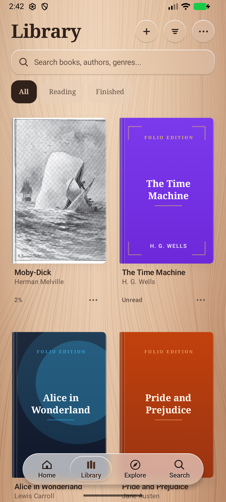
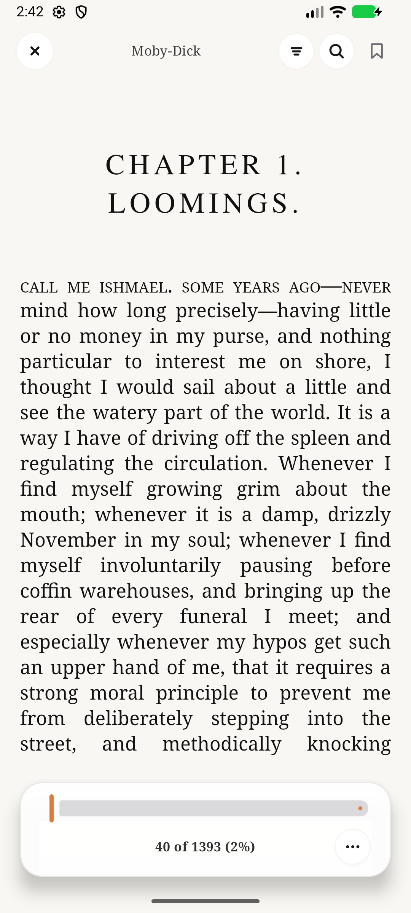

# Folio

Folio is an offline-first EPUB and PDF reader for Android. Heavily inspired by Apple Books, it pairs a personal library with a distraction-free reader and interactive page turns for EPUBs.

<p>
  
  
</p>

## Features

- **Offline library.** Import EPUB and PDF files from your device, browse in a grid or list, and sort and search your collection. Books are available offline once imported.
- **Interactive EPUB page turns.** Drag the page to curl it as you read. The page follows your finger through the turn.
- **Progress and bookmarks.** Resume where you left off, save pages to revisit, and jump through a book using the progress slider.
- **EPUB text controls.** Adjust the text size in steps and add or remove highlights as you read.
- **App and reader themes.** Follow your system appearance or choose Light Mode, Dark Mode, Blush Bloom, Walnut Library, or Copper Horizon. The reader has separate options in Warm Paper, Sepia, Dark, and White.
- **Explore.** Browse a third-party book site inside Folio. Completed EPUB and PDF downloads appear at the top of your local library. Explore requires an internet connection.

## Installation

Folio runs on Android 8.0 and newer. Published APKs are listed on [GitHub Releases](https://github.com/tejesh-zephaniah/Folio/releases). You can also build a debug APK using the steps below.

## Building from source

Folio is built with Kotlin and Jetpack Compose and uses Readium for EPUB and PDF rendering. Open the project in Android Studio with Android SDK 37 installed, then run the `app` configuration on a device or emulator.

To build the debug APK and run the unit tests from PowerShell, run

```powershell
.\gradlew.bat :app:assembleDebug :app:testDebugUnitTest
```

On macOS or Linux, run `./gradlew :app:assembleDebug :app:testDebugUnitTest`. The debug APK is written to `app/build/outputs/apk/debug/app-debug.apk`.
